# 🏛️ DUDC V4.0 Studio - Master Knowledge Vault & Map of Content (MOC)
### استوديو ومنظومة إصدار شهادات الرفع المساحي المعتمدة والرقابة الرقمية (الإصدار الرابع - النسخة المحمولة)
**مركز معلومات شبكات المرافق - محافظة الدقهلية (Dakahlia Utility Data Center)**

> [!IMPORTANT]
> **AI AGENT & DEVELOPER INSTRUCTION:**
> **DO NOT** re-read or recursively crawl the entire codebase for every prompt!
> Consult this Vault first. Use [[Developer Decision Matrix]] and the indexed subsystem notes below to immediately pinpoint the 1 or 2 specific files required for any task.

---

## 🧭 Vault Navigation & Subsystems

```mermaid
flowchart TD
    MOC["🗺️ 00 - Vault MOC"] --> ARCH["🏛️ 01 - System Architecture"]
    MOC --> GIS["📐 02 - Core GIS Engine"]
    MOC --> SRV["⚙️ 03 - Backend Services"]
    MOC --> FE["💻 04 - Frontend Studio"]
    MOC --> MATRIX["🎯 05 - Decision Matrix & Rules"]
    MOC --> TEST["🧪 06 - Testing & Diagnostics"]
    MOC --> DEPLOY["🚀 07 - Runtime & Deployment"]

    ARCH --> PIPE["System Architecture & Data Pipeline"]
    ARCH --> THREAD["Thread-Safety & Concurrency Model"]
    ARCH --> TOKEN["Security Token Protocol (Modal Cloud)"]
    ARCH --> RUNTIME["Portable Zero-Install Runtime Design"]

    GIS --> MODELS["Cadastral Models (models.py)"]
    GIS --> GEO["Geodesic Engine & Tolerance (geo.py)"]
    GIS --> CROQ["CAD Croquis Generator (croquis.py)"]
    GIS --> SAT["Satellite Tile Engine (satellite.py)"]
    GIS --> JURIS["Jurisdictions & 18 Centers (jurisdictions)"]

    SRV --> APPSRV["Application Server (app_server.py)"]
    SRV --> HANDLERS["REST API Catalog (handlers.py)"]
    SRV --> SESSION["Session Manager (session_manager.py)"]
    SRV --> CFG["Config & Visual Explorer (config.py)"]
    SRV --> PDF["PDF Exporter (pdf_service.py)"]
    SRV --> DRAFTS["Drafts Service (drafts_service.py)"]

    FE --> STAGE1["Stage 1 - Survey Ingestion (stage1.js)"]
    FE --> STAGE2["Stage 2 - Studio Editor (stage2.js)"]
    FE --> STAGE3["Stage 3 - Official Issuance (stage3.js)"]
    FE --> CSS["CSS Design System & Print Rules (css)"]

    MATRIX --> DECISION["Developer Decision Matrix"]
    MATRIX --> INVARIANTS["Strict System Invariants"]
    MATRIX --> RECIPES["Common Modification Recipes"]
```

---

## ⚡ Quick Developer Routing Table (Where to Look First)

When asked to inspect or modify a feature, skip repo scanning and jump directly to these files:

| Task / Feature Request | Target Note in Vault | Target Source File(s) in Codebase |
|---|---|---|
| **Area tolerance ($\pm 2.0\text{ m}^2$), Excel/CSV reading, coordinate parsing** | [[Geodesic Engine & Tolerance (geo.py)]] | [`DUDC V3/core_gis/geo.py`](file:///d:/Work/certi_processing_tools/project_dudc/DUDC%20V3/core_gis/geo.py) |
| **CAD Croquis appearance, label positions, font sizes, line width, compass** | [[CAD Croquis Generator (croquis.py)]] | [`DUDC V3/core_gis/croquis.py`](file:///d:/Work/certi_processing_tools/project_dudc/DUDC%20V3/core_gis/croquis.py) |
| **Google Satellite tiles, tile stitching, polygon overlay** | [[Satellite Tile Engine (satellite.py)]] | [`DUDC V3/core_gis/satellite.py`](file:///d:/Work/certi_processing_tools/project_dudc/DUDC%20V3/core_gis/satellite.py) |
| **Modal.com cloud token API, audit log confirmation** | [[Security Token Protocol (Modal Cloud)]] | [`DUDC V3/core_gis/security.py`](file:///d:/Work/certi_processing_tools/project_dudc/DUDC%20V3/core_gis/security.py) |
| **18 Dakahlia Centers, Arabic name normalization** | [[Jurisdictions & 18 Centers (jurisdictions)]] | [`DUDC V3/core_gis/jurisdictions/`](file:///d:/Work/certi_processing_tools/project_dudc/DUDC%20V3/core_gis/jurisdictions/) |
| **REST API endpoints, request/response handlers** | [[REST API Catalog (handlers.py)]] | [`DUDC V3/server/handlers.py`](file:///d:/Work/certi_processing_tools/project_dudc/DUDC%20V3/server/handlers.py) |
| **Thread synchronization, in-memory parcel state** | [[Session Manager (session_manager.py)]] | [`DUDC V3/server/session_manager.py`](file:///d:/Work/certi_processing_tools/project_dudc/DUDC%20V3/server/session_manager.py) |
| **Output directory picker, multi-drive explorer backend** | [[Config & Visual Explorer (config.py)]] | [`DUDC V3/server/config.py`](file:///d:/Work/certi_processing_tools/project_dudc/DUDC%20V3/server/config.py) |
| **Microsoft Edge headless PDF rendering** | [[PDF Exporter (pdf_service.py)]] | [`DUDC V3/server/pdf_service.py`](file:///d:/Work/certi_processing_tools/project_dudc/DUDC%20V3/server/pdf_service.py) |
| **Draft saving/loading, base64 image persistence** | [[Drafts Service (drafts_service.py)]] | [`DUDC V3/server/drafts_service.py`](file:///d:/Work/certi_processing_tools/project_dudc/DUDC%20V3/server/drafts_service.py) |
| **GitHub automatic update checker & puller** | [[Git Update Service (git_service.py)]] | [`DUDC V3/server/git_service.py`](file:///d:/Work/certi_processing_tools/project_dudc/DUDC%20V3/server/git_service.py) |
| **Server startup, port recovery (8765-8785)** | [[Application Server (app_server.py)]] | [`DUDC V3/app_server.py`](file:///d:/Work/certi_processing_tools/project_dudc/DUDC%20V3/app_server.py) |
| **Stage 1 UI: Survey file upload, parcel cards, tables** | [[Stage 1 - Survey Ingestion (stage1.js)]] | [`DUDC V3/js/stage1.js`](file:///d:/Work/certi_processing_tools/project_dudc/DUDC%20V3/js/stage1.js) |
| **Stage 2 UI: Studio live certificate editor, typography** | [[Stage 2 - Studio Editor (stage2.js)]] | [`DUDC V3/js/stage2.js`](file:///d:/Work/certi_processing_tools/project_dudc/DUDC%20V3/js/stage2.js) |
| **Stage 3 UI: Cloud issuance, printing & export** | [[Stage 3 - Official Issuance (stage3.js)]] | [`DUDC V3/js/stage3.js`](file:///d:/Work/certi_processing_tools/project_dudc/DUDC%20V3/js/stage3.js) |
| **In-app visual folder browser frontend** | [[In-App Folder Explorer UI (folder_explorer.js)]] | [`DUDC V3/js/folder_explorer.js`](file:///d:/Work/certi_processing_tools/project_dudc/DUDC%20V3/js/folder_explorer.js) |
| **Certificate A4 styling, margins, print colors** | [[CSS Design System & Print Rules (css)]] | [`DUDC V3/css/certificate.css`](file:///d:/Work/certi_processing_tools/project_dudc/DUDC%20V3/css/certificate.css) + [`print.css`](file:///d:/Work/certi_processing_tools/project_dudc/DUDC%20V3/css/print.css) |
| **Unit tests & regression verification** | [[Automated Test Suite (tests)]] | [`tests/`](file:///d:/Work/certi_processing_tools/project_dudc/tests/) |
| **Portable batch launchers & zero-install environment** | [[Startup Scripts & Shortcuts]] | [`Run_DUDC_V4.bat`](file:///d:/Work/certi_processing_tools/project_dudc/Run_DUDC_V4.bat), [`Setup_Portable_Runtime.bat`](file:///d:/Work/certi_processing_tools/project_dudc/Setup_Portable_Runtime.bat) |

---

## 🛡️ Critical System Invariants (Never Violate These)

1. **Strict Geodesic Area Tolerance:** The maximum allowable discrepancy $|\Delta|$ between stated area and WGS84 calculated area is **$\pm 2.00\text{ m}^2$**. Exceeding this triggers mandatory manual revision (`MANUAL_REVISION`).
2. **Citizen Output Naming Standard:** All export folders and files MUST follow the pattern:
   `[اسم العميل]-[المركز]` (e.g. `أحمد محمد إبراهيم-طلخا/` containing `أحمد محمد إبراهيم-طلخا.pdf` and `أحمد محمد إبراهيم-طلخا_session.json`).
3. **Missing Data Policy:** Empty or zero values for national ID, receipt, or request numbers MUST display the explicit Arabic string **"لا يوجد بيانات متاحة"**. NEVER invent dummy data.
4. **Image Upload Boundary:** Custom image upload buttons are permitted **ONLY in Stage 1**. They must remain completely hidden in Stage 2 (Studio) and Stage 3 to guarantee clean, printable document output.
5. **Session Recovery Integrity:** Every JSON draft and export session must embed Croquis and Satellite imagery directly as `data:image/...;base64,...` so the project can be reopened offline on any machine without broken asset links.
6. **Thread-Safe Matplotlib Rendering:** Matplotlib must use the object-oriented API (`Figure`, `FigureCanvasAgg`) with `matplotlib.use('Agg')`—never call `plt.*` stateful methods on the server.
7. **Zero-PowerShell Visual Browsing:** The in-app folder explorer must navigate directories purely via Python's native `os.scandir` without invoking external shell or PowerShell processes, avoiding AV/AppLocker freezes.

---

## 📚 Vault Detailed Index by Section

### [[01 - 🏛️ System Architecture/]]
- [[System Architecture & Data Pipeline]] - End-to-end processing pipeline, data transformations, and state machine.
- [[Thread-Safety & Concurrency Model]] - In-memory locks, Matplotlib OO isolation, and headless Edge worker safety.
- [[Security Token Protocol (Modal Cloud)]] - 210-bit anti-tamper security token architecture and cloud audit verification.
- [[Portable Zero-Install Runtime Design]] - 32-bit Python 3.11 embeddable runtime, pre-compiled wheels, zero-internet compatibility.

### [[02 - 📐 Core GIS Engine/]]
- [[Core GIS Engine Overview]] - The standalone, decoupled `core_gis` package structure and public API.
- [[Cadastral Models (models.py)]] - Typed dataclasses (`CadastralParcel`, `Vertex`, `Segment`, `Boundaries`).
- [[Geodesic Engine & Tolerance (geo.py)]] - WGS84 ellipsoid math, multi-format parsing, coordinate deduping, ring closure detection.
- [[CAD Croquis Generator (croquis.py)]] - Thread-safe vector sketching, BiDi Arabic reshaping, interior/exterior edge annotations.
- [[Satellite Tile Engine (satellite.py)]] - Multi-threaded Google satellite tile fetcher, zoom calculation, parcel boundary raster overlay.
- [[Cloud Security Client (security.py)]] - Modal.com JSON API interaction, key handling, trial preview token.
- [[Jurisdictions & 18 Centers (jurisdictions)]] - The 18 official Dakahlia centers, morphological normalization, extensible base provider.

### [[03 - ⚙️ Backend Services/]]
- [[Backend Services Overview]] - Overview of `server/` modules and separation of concerns.
- [[Application Server (app_server.py)]] - Multi-threaded HTTP server, anti-hang DNS override, dynamic port failover (8765-8785).
- [[REST API Catalog (handlers.py)]] - Complete specification for all 28 GET/POST endpoints with schemas.
- [[Session Manager (session_manager.py)]] - Thread-safe state holder, live memory sync, active session recovery.
- [[Config & Visual Explorer (config.py)]] - System drive discovery, native folder pickers, resilient directory traversal.
- [[PDF Exporter (pdf_service.py)]] - Microsoft Edge headless PDF vector pipeline, print media CSS hooks.
- [[Drafts Service (drafts_service.py)]] - Self-contained JSON drafts with embedded base64 graphics.
- [[Git Update Service (git_service.py)]] - Safe GitHub sync with merge conflict auto-stash recovery.

### [[04 - 💻 Frontend Studio/]]
- [[Frontend Architecture & State]] - Three-stage wizard flow, shared state management, event bus.
- [[Stage 1 - Survey Ingestion (stage1.js)]] - Survey parsing, tolerance badges, coordinate tables, image uploaders.
- [[Stage 2 - Studio Editor (stage2.js)]] - Live certificate canvas, typography customizer, watermark generator, reverse DOM sync.
- [[Stage 3 - Official Issuance (stage3.js)]] - Cloud issuance lock, package exporter, PDF print automation.
- [[Drafts Drawer & Auto-Save (drafts.js)]] - 45-second background auto-save loop, draft drawer, restore mechanics.
- [[In-App Folder Explorer UI (folder_explorer.js)]] - Directory browser modal, quick-jump locations, instant folder creation.
- [[CSS Design System & Print Rules (css)]] - Design tokens, glassmorphism cards, and exact A4 `@media print` rules.

### [[05 - 🎯 Developer Quick-Target Matrix/]]
- [[Developer Decision Matrix]] - Instant feature-to-file lookup table.
- [[Strict System Invariants]] - The 10 golden rules of the DUDC codebase.
- [[Common Modification Recipes]] - Step-by-step implementation playbooks for frequent tasks.

### [[06 - 🧪 Testing & Diagnostics/]]
- [[Automated Test Suite (tests)]] - Test suite breakdown (`test_geo`, `test_jurisdictions`, `test_croquis`, `test_folder_explorer`, `test_endpoints`).
- [[Running Tests & Diagnostics]] - How to run tests, interpret results, and verify fixes.

### [[07 - 🚀 Runtime & Deployment/]]
- [[Startup Scripts & Shortcuts]] - Deep dive into `Run_DUDC_V3.bat`, `Run_DUDC_V4.bat`, and desktop shortcut automation.
- [[Dependencies & Wheels Matrix]] - Comprehensive list of packages, exact versions, and pre-compiled 32-bit wheels.

