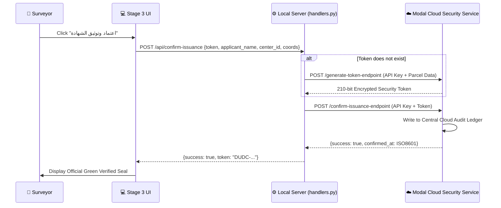

# 🔒 Security Token Protocol (Modal Cloud)

To prevent forgery of official cadastral certificates issued by the Dakahlia Utility Data Center, the system implements an **anti-tamper cryptographic security token protocol** hosted on a cloud-isolated microservice on Modal.com.

---

## 🏗️ Architecture & Isolation

---

## 🔑 Key Protocol Specifications

1. **Zero Client Cryptographic Secrets:**
   - No Feistel ciphers, decryption keys, or hashing salts reside on the local workstation or within the application source code.
   - All cryptographic token synthesis is performed exclusively inside the secure Modal environment.
2. **Endpoints:**
   - **Generation:** `https://killd00zer--dudc-security-service-generate-token-endpoint.modal.run`
   - **Confirmation:** `https://killd00zer--dudc-security-service-confirm-issuance-endpoint.modal.run`
   - **Office Key:** `DUDC_DAKAHLIA_OFFICE_SECRET_2026_KEY`
3. **Audit Ledger & Issuance Lock:**
   - A certificate cannot be exported or printed as an official document without being confirmed in the central ledger.
   - Local offline generation is strictly blocked. If the internet connection is broken, the user is alerted to re-establish connectivity.
4. **Trial / Preview Token:**
   - During drafting, previewing, and design in Stage 2, the system utilizes a dedicated trial token:
     `DUDC-TRIAL-SAMPLE-PREVIEW-000000-000000`
   - This allows surveyors to adjust spacing and test layout without polluting the official central issuance audit log.

