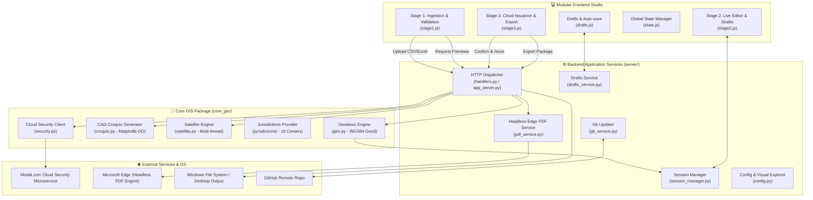

# 🏛️ System Architecture & Data Pipeline

The **DUDC V4.0 Cadastral Certificate Workflow Studio** is designed around a three-tier, decoupled, modular architecture:
1. **Presentation Layer (Frontend):** Vanilla JS, CSS3, and HTML5 divided into 3 distinct functional stages.
2. **Application Server & REST Layer:** Multi-threaded Python HTTP server (`server/`) with specialized micro-services.
3. **Core GIS & Domain Engine (`core_gis/`):** Pure mathematical, geodesic, rendering, and security algorithms with zero server dependencies.

---

## 🔄 End-to-End Processing Lifecycle

### Phase 1: Survey File Ingestion & Spatial Sanitization
1. **User Action:** The technician drags an Excel (`.xls`, `.xlsx`) or `.csv` file onto Stage 1 (or clicks "⚡ تجربة العينة المرفقة").
2. **Server Route:** Sent via multipart POST to `/api/upload`.
3. **Core Processing (`core_gis/geo.py`):**
   - Automatically detects encoding (`utf-8-sig`, `utf-8`, `cp1256`).
   - Resolves columns flexibly using fuzzy string matching.
   - Cleans coordinate fields and strips Arabic numerals.
   - **Coordinate Deduplication:** Consecutive coordinates closer than $10^{-9}$ degrees (~0.1 mm) are merged.
   - **Ring Closure Detection:** If the first and last coordinates match, the redundant closure vertex is popped.
   - Re-indexes vertices sequentially $1 \dots N$.
4. **Geodesic Calculation:**
   - Evaluates perimeter and polygon area using `pyproj.Geod(ellps='WGS84')`.
   - Computes discrepancy $\Delta = \text{Calculated Area} - \text{Stated Area}$.
   - Tests against condition $|\Delta| \le 2.00\text{ m}^2$. If passed, sets status to `PASS`; otherwise `MANUAL_REVISION`.
5. **District Normalization:** Calls `core_gis.resolve_center()` to match against the 18 official Dakahlia centers.
6. **Preview Assets:** Triggers thread-safe background generation of CAD Croquis sketch (`/temp_assets/croq_0.png`) and Google Satellite tile capture (`/temp_assets/sat_0.jpg`).

---

### Phase 2: Live Cadastral Studio & Document Design
1. **State Synchronization (`stage2.js`):**
   - When entering Stage 2, `syncStage1ToStage2(true)` populates the A4 certificate layout with parcel data.
   - If the user modifies coordinates or text in Stage 2, `syncStage2ToStage1()` provides bidirectional synchronization.
2. **Interactive Controls:**
   - Visual Spacing slider: Adjusts table padding, row heights, and layout gaps dynamically.
   - Watermark generator: Paints the official DUDC watermark canvas on the certificate background.
   - Typography controls: Adjusts font size, weights, line widths, and dimension annotation sizes.
   - Image Studio: Provides real-time panning, cropping, and contrast adjustment for Croquis and Satellite graphics.
3. **Draft Auto-save Loop (`drafts.js`):**
   - Every 45 seconds, the state is serialized into a self-contained JSON draft with embedded base64 images and written to `drafts/draft_<id>.json`.

---

### Phase 3: Cloud Verification & Final Package Export
1. **Issuance Request (`stage3.js`):**
   - The user clicks "اعتماد وتصدير الشهادة".
   - Server requests a signed 210-bit token from Modal.com cloud service (`/api/confirm-issuance`).
   - If offline or invalid, issuance fails and user is notified.
2. **Package Creation (`/api/export-package`):**
   - Server resolves output directory (defaults to current user's Windows Desktop).
   - Creates a dedicated folder named `[اسم العميل]-[المركز]`.
   - Generates vector A4 PDF using Microsoft Edge headless (`--headless --print-to-pdf`).
   - Saves session state to `[اسم العميل]-[المركز]_session.json` with embedded base64 images.
   - Saves high-res `croquis_[اسم العميل].png` and `satellite_[اسم العميل].jpg`.
   - Copies the original raw survey file into the folder for archival.
   - Automatically deletes active temporary draft from `drafts/`.
   - Launches Windows File Explorer pointing to the newly generated package via `/api/open-folder`.

