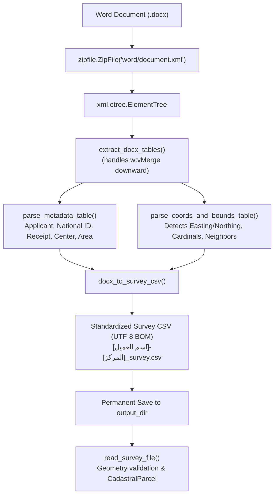

# 📄 Word Cadastral Certificate (.docx) Parser & CSV Generator
`DUDC V3/core_gis/docx_parser.py`

## Overview & Purpose
Extracts cadastral survey data, applicant metadata, boundary directions, neighbors, lengths, and coordinate vertices (Easting/Lon and Northing/Lat) directly from official cadastral certificates provided as Microsoft Word documents (`.docx`).

### Key Design Pillars
1. **Zero External Dependencies:** Built entirely with Python standard library modules (`zipfile`, `xml.etree.ElementTree`, `re`, `csv`). Does NOT require `python-docx` or third-party packages, guaranteeing 100% compatibility with embedded and 32-bit portable runtimes.
2. **Permanent CSV Preservation:** Whenever a Word certificate is uploaded, the engine automatically synthesizes a standard survey CSV file encoded in `utf-8-sig` (with BOM for Excel compatibility) and permanently saves it into the active output directory:
   `<output_dir>/[اسم العميل]-[المركز]_survey.csv`.
3. **Multi-Format Tolerance:** Handles certificates with unified tables (boundaries + coordinates combined) or separate dedicated tables for metadata, boundaries, and coordinates.

---

## Architecture & Data Flow

---

## Coordinate & Bounds Extraction Protocol

### 1. Header Auto-Detection
The parser scans table header cells to locate explicit coordinate columns:
- **Easting / Lon (X):** Matches `شرقيات`, `شرق`, `x`, `e`, `easting`, `خط الطول`.
- **Northing / Lat (Y):** Matches `شماليات`, `y`, `n`, `northing`, `دائرة العرض`, `دوائر العرض`.
- **Boundaries:** Matches `الحد البحري`, `الحد القبلي`, `الحد الشرقي`, `الحد الغربي`.

### 2. Headerless Coordinate Fallback
When no explicit headers exist:
- Detects neighbor descriptions by skipping length keywords (`بطول`) and coordinates.
- Filters out parcel boundary lengths (which precede coordinates or follow `بطول`).
- Selects coordinate pairs with geodesic validation (WGS84 Egyptian range: $20^\circ \le \text{coord} \le 40^\circ$, or projected ETM range: $100,000 \le \text{coord} \le 5,000,000$).

---

## Output CSV Schema

The generated CSV conforms strictly to `core_gis/geo.py`:

| Header | Sample Value | Description |
|---|---|---|
| `ORIG_FID` | `1` | Parcel group identifier |
| `اسم مقدم الطلب` | `السيد أحمد علي إبراهيم` | Citizen / Applicant Name |
| `الرقم القومي` | `29501011234567` | National ID (14 digits) |
| `رقم ايصال السداد` | `789456` | Official Payment Receipt No |
| `المركز` | `طلخا` | Dakahlia Center / District |
| `القرية` | `دميرة` | Village / Quarter |
| `العنوان` | `حوض الزهور` | Physical site address |
| `المساحة م2` | `450.50` | Stated area in square meters |
| `وصف التعامل` | `إنشاء مبنى سكني` | Purpose of transaction |
| `وصف الموقع` | `أرض فضاء` | Current site status |
| `رقم الطلب` | `102` | Cadastral request number |
| `الحد_البحري` | `شارع بعرض 12 متر` | Northern limit & neighbor |
| `الحد_القبلي` | `ملك ورثة محمد حسن` | Southern limit & neighbor |
| `الحد_الشرقي` | `شارع جانبي` | Eastern limit & neighbor |
| `الحد_الغربي` | `ملك علي محمود` | Western limit & neighbor |
| `POINT_X` | `31.38150000` | Longitude / Easting (8 decimals) |
| `POINT_Y` | `31.05120000` | Latitude / Northing (8 decimals) |

---

## Integration Endpoints

- **`POST /api/upload-docx`** in [`handlers.py`](file:///d:/Work/certi_processing_tools/project_dudc/DUDC%20V3/server/handlers.py):
  1. Accepts uploaded `.docx` file.
  2. Synthesizes permanent CSV in `SESSION_MANAGER.get_output_dir()`.
  3. Registers CSV in `SESSION_MANAGER.set_survey_data()`.
  4. Pre-generates Croquis & Satellite preview images.
  5. Returns parcel data to Stage 1.
- **`GET /api/download-survey-csv`**:
  Allows downloading the synthesized CSV file directly from the browser.
- **`POST /api/export-package`**:
  Automatically archives a permanent copy of the CSV file inside the exported citizen folder (`[اسم العميل]-[المركز]/`).

