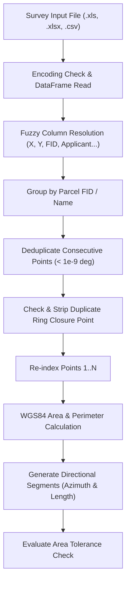

# 📐 Geodesic Engine & Tolerance (`geo.py`)

File: [`DUDC V3/core_gis/geo.py`](file:///d:/Work/certi_processing_tools/project_dudc/DUDC%20V3/core_gis/geo.py)

Responsible for reading multi-format survey files, sanitizing coordinates, performing high-precision ellipsoidal geodesic math on WGS84, and enforcing the $\pm 2.00\text{ m}^2$ area tolerance law.

---

## 🧮 Mathematical Foundations

The Earth's curvature cannot be modeled accurately by simple Euclidean planar formulas ($x, y$) over wide zones. The engine initializes `pyproj.Geod`:
```python
from pyproj import Geod
GEOD = Geod(ellps='WGS84')
```

1. **Polygon Geodesic Area & Perimeter:**
   ```python
   area_raw, perimeter_m = GEOD.polygon_area_perimeter(lons, lats)
   calc_area_m2 = round(abs(area_raw), 2)
   ```
2. **Geodesic Inverse (Distance & Azimuth):**
   ```python
   fwd_az, back_az, dist = GEOD.inv(lon1, lat1, lon2, lat2)
   ```

---

## 🔍 Ingestion & Sanitization Pipeline (`read_survey_file`)



### 1. Robust Column Matching
The engine uses fuzzy, multi-candidate column lookups matching Arabic and English field names:
- Coordinates: `POINT_X`, `POINT X`, `LONG`, `Easting`, `X` | `POINT_Y`, `POINT Y`, `LAT`, `Northing`, `Y`
- Applicant: `اسم مقدم الطلب`, `اسم_مقدم_الطلب`, `اسم مقدم`, `applicant`
- National ID: `الرقم القومي`, `الرقم_القومي`, `national_id`
- Receipt: `رقم ايصال السداد`, `رقم_ايصال_السداد`, `ايصال`, `receipt`
- Area: `المساحة م2`, `المساحة_م2`, `المساحة`, `area`

### 2. Geometry Cleaning Algorithms
- **Consecutive Duplicate Filter:** Removes jitter or duplicate coordinates where $|lon_i - lon_{i-1}| < 10^{-9}$ and $|lat_i - lat_{i-1}| < 10^{-9}$.
- **Ring Closure Correction:** Many CAD/GIS exports duplicate the first point as the last point. The engine automatically detects this and removes the redundant final point so vertices match actual polygon corners.

---

## ⚖️ The $\pm 2.00\text{ m}^2$ Legal Area Tolerance Rule

```python
stated_area_m2 = parcel.get("stated_area_m2", 0.0)
area_diff = round(calc_area_m2 - stated_area_m2, 2)
is_area_pass = abs(area_diff) <= 2.00
validation_status = "PASS" if is_area_pass else "MANUAL_REVISION"
```
- If $|\Delta| \le 2.00\text{ m}^2$: Parcel receives green **"مطابق للتفاوت القانوني"** status.
- If $|\Delta| > 2.00\text{ m}^2$: Parcel receives yellow warning badge requiring manual technician review before certificate issuance.

