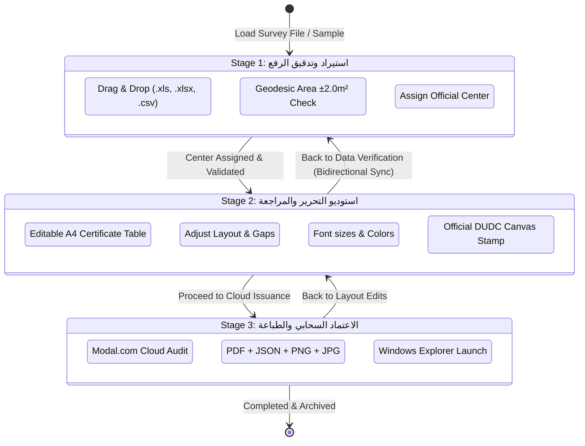

# 💻 Frontend Architecture & State

The DUDC V4.0 user interface is designed as an interactive, single-page application (SPA) built without heavy JavaScript frameworks (React/Vue/Angular), ensuring zero build steps, ultra-fast initial render, and complete offline independence.

---

## 🗂️ Script Modularization Map

```text
DUDC V3/js/
├── state.js                   # Global variables, workflow navigation, stage tabs
├── stage1.js                  # Survey ingestion, parcel cards, tables, image uploaders
├── stage2.js                  # Live A4 certificate editor, typography, spacing, watermark
├── stage3.js                  # Official cloud issuance verification, printing & export
├── drafts.js                  # Draft drawer, auto-save timers, session restoration
├── folder_explorer.js         # In-app visual folder browser modal
└── app.js                     # System bootstrap, keyboard shortcuts, update checks
```

---

## 🧭 Three-Stage Wizard State Machine



---

## 🌐 Global Variables (`state.js`)
- `currentStage: int` - Active stage index ($1, 2, 3$).
- `activeParcel: Optional[Object]` - Primary parcel record currently displayed and edited.
- `currentSegments: Array` - Segment boundary array with directions, lengths, azimuths, and neighbors.
- `outputDir: string` - Currently selected Windows output directory path.
- `savedTextDefaults: Object` - User typography preferences loaded from `user_default_settings.json`.
- `hasSavedCurrentPackage: bool` - Safety flag: strictly blocks printing before official package export.
- `officialCentersList: Array` - Array of $[id, name]$ for the 18 Dakahlia centers.

### Stage Transition Handlers (`switchStage(stageNum)`)
- **Exiting Stage 2:** Calls `saveCurrentStudioTextState()` and `syncDomToActiveParcel()` to preserve custom font styles and inline text edits.
- **Entering Stage 2:** Calls `syncStage1SegmentsToParcel()`, `syncStage1ToStage2(true)`, `updateSpacing()`, and `renderWatermark()`.
- **Exiting to Stage 1:** Calls `syncStage2ToStage1()` so any manual changes made on the certificate table reflect back in the coordinate table.

