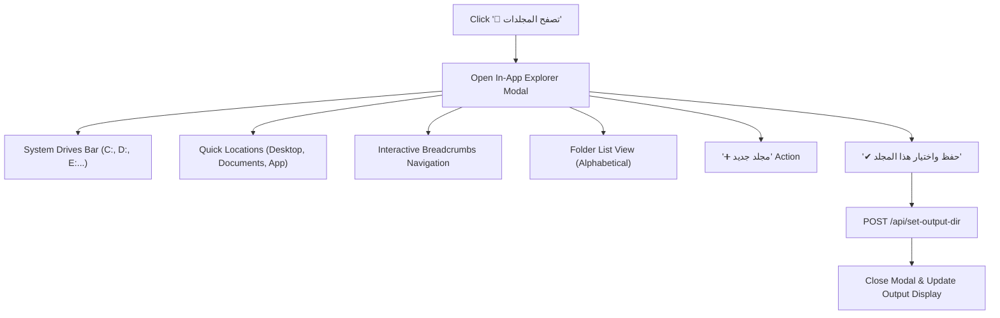

# 💻 In-App Folder Explorer UI (`folder_explorer.js`)

File: [`DUDC V3/js/folder_explorer.js`](file:///d:/Work/certi_processing_tools/project_dudc/DUDC%20V3/js/folder_explorer.js)

Provides an in-browser visual directory browser that allows selecting or creating destination folders without relying on OS shell windows.

---

## 🖥️ UI Components & Flow

---

## ⚡ Zero-PowerShell Features
1. **Interactive Breadcrumbs:** Clicking any segment in the breadcrumb path jumps directly up the directory tree.
2. **Drive Switcher:** Automatically discovers all physical drives and network shares (`/api/quick-locations`).
3. **Instant Folder Creation:** Prompts for folder name, validates characters, creates the directory on disk via Python (`/api/create-directory`), and navigates into it immediately.
4. **Live Permission Indicator:** Shows green `✔ قابل للكتابة وحفظ الشهادات` or red warning if the folder is read-only.

