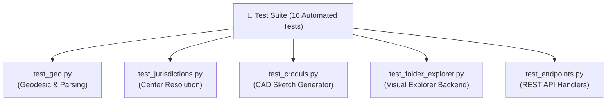

# 🧪 Automated Test Suite (`tests`)

Directory: [`tests/`](file:///d:/Work/certi_processing_tools/project_dudc/tests/)

The project is backed by an automated regression test suite covering core geodesic mathematics, administrative name normalization, CAD image rendering, folder exploration, and REST endpoints.

---

## 📋 Test Modules & Scope

### 1. `tests/test_geo.py`
- Tests string numeral sanitization (`clean_num_str`, Arabic $\to$ Western digits).
- Tests National ID / Receipt number cleaning (`clean_id_field`), verifying scientific notation handling (e.g. `2.99E+13`) and zero suppression.
- Tests geodesic area calculations against the $\pm 2.00\text{ m}^2$ tolerance law:
  - Discrepancy $\le 2.00\text{ m}^2 \implies \text{PASS}$.
  - Discrepancy $> 2.00\text{ m}^2 \implies \text{MANUAL\_REVISION}$.
- Tests reading standard Excel survey file (`ف.xls`).

### 2. `tests/test_jurisdictions.py`
- Tests exact matching of the 18 Dakahlia centers.
- Tests Arabic text morphological normalization (stripping prefixes `مركز `, `مدينة `, `حي `, unifying Alef, Taa Marbuta, and removing diacritics).
- Tests fuzzy substring resolution (e.g. `"حي غرب المنصورة"` $\to$ `"المنصورة"`).

### 3. `tests/test_croquis.py`
- Tests object-oriented Matplotlib croquis rendering.
- Verifies generation of 300 DPI high-res PNG image.
- Tests interior segment length annotations and exterior neighbor descriptions.
- Verifies thread isolation with zero `pyplot` leakage.

### 4. `tests/test_folder_explorer.py`
- Tests dynamic Windows Desktop discovery (`get_safe_default_output_dir`).
- Tests system drives enumeration (`get_system_drives`).
- Tests quick shortcut generation (Desktop, Documents, Downloads).
- Tests folder listing and write-permission verification without PowerShell.
- Tests subdirectory creation and character sanitization.

### 5. `tests/test_endpoints.py`
- Tests HTTP GET routes: `/api/health`, `/api/get-defaults`, `/api/get-centers`, `/api/quick-locations`.
- Tests HTTP POST route: `/api/validate-path`.

